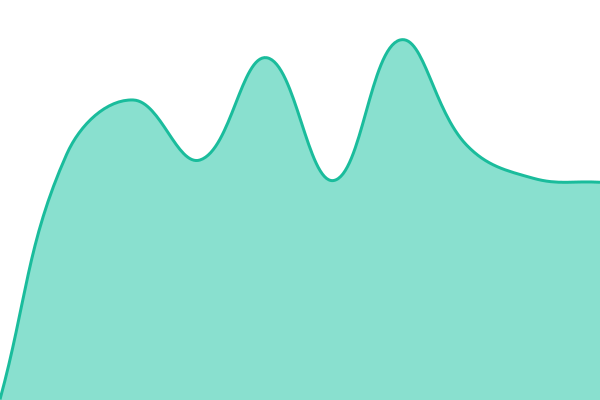
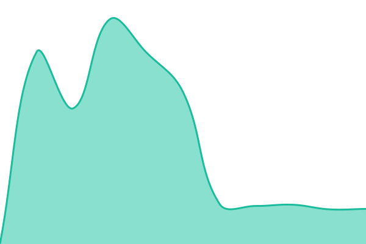
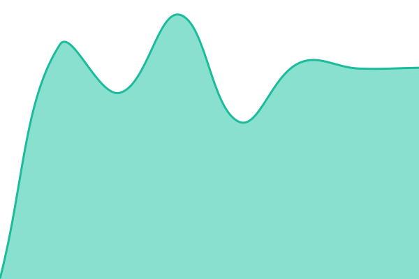
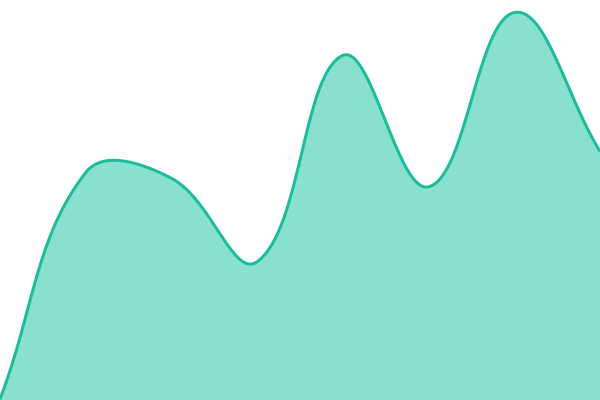

# [📈 Live Status](https://status.jinc.io): <!--live status--> **🟩 All systems operational**

This repository contains the open-source uptime monitor and status page for [Jan-Niklas](https://jnnkls.wtf), powered by [Upptime](https://github.com/upptime/upptime).

With [Upptime](https://upptime.js.org), you can get your own unlimited and free uptime monitor and status page, powered entirely by a GitHub repository. We use [Issues](https://github.com/jnnkls/jinc-upptime/issues) as incident reports, [Actions](https://github.com/jnnkls/jinc-upptime/actions) as uptime monitors, and [Pages](https://status.jinc.io) for the status page.

<!--start: status pages-->
<!-- This summary is generated by Upptime (https://github.com/upptime/upptime) -->
<!-- Do not edit this manually, your changes will be overwritten -->
<!-- prettier-ignore -->
| URL | Status | History | Response Time | Uptime |
| --- | ------ | ------- | ------------- | ------ |
|  [homepage](https://jnnkls.dev) | 🟩 Up | [homepage.yml](https://github.com/jnnkls/jinc-upptime/commits/HEAD/history/homepage.yml) | 

 521ms
     
 | 

<a href="https://status.jinc.io/history/homepage">100.00%</a>
    

|  [joshirando.de](https://joshirando.de) | 🟩 Up | [joshirando-de.yml](https://github.com/jnnkls/jinc-upptime/commits/HEAD/history/joshirando-de.yml) | 

 578ms
     
 | 

<a href="https://status.jinc.io/history/joshirando-de">100.00%</a>
    

|  [Mail](https://mail.jinc.io) | 🟩 Up | [mail.yml](https://github.com/jnnkls/jinc-upptime/commits/HEAD/history/mail.yml) | 

 186ms
     
 | 

<a href="https://status.jinc.io/history/mail">100.00%</a>
    

|  [ID (SSO)](https://id.jinc.io) | 🟩 Up | [id-sso.yml](https://github.com/jnnkls/jinc-upptime/commits/HEAD/history/id-sso.yml) | 

 810ms
     
 | 

<a href="https://status.jinc.io/history/id-sso">100.00%</a>
    

|  [ntfy](https://ntfy.jinc.io/v1/health) | 🟩 Up | [ntfy.yml](https://github.com/jnnkls/jinc-upptime/commits/HEAD/history/ntfy.yml) | 

 108ms
     
 | 

<a href="https://status.jinc.io/history/ntfy">100.00%</a>
    

|  [Bastion](https://bastion.jinc.io) | 🟩 Up | [bastion.yml](https://github.com/jnnkls/jinc-upptime/commits/HEAD/history/bastion.yml) | 

 86ms
     
 | 

<a href="https://status.jinc.io/history/bastion">100.00%</a>
    

|  [Matrix](https://matrix.jnnkls.wtf/_matrix/client/versions) | 🟩 Up | [matrix.yml](https://github.com/jnnkls/jinc-upptime/commits/HEAD/history/matrix.yml) | 

 548ms
     
 | 

<a href="https://status.jinc.io/history/matrix">100.00%</a>
    

|  [Immich](https://immich.jinc.io/api/server/ping) | 🟩 Up | [immich.yml](https://github.com/jnnkls/jinc-upptime/commits/HEAD/history/immich.yml) | 

 138ms
     
 | 

<a href="https://status.jinc.io/history/immich">97.64%</a>
    

|  [n8n](https://n8n.jinc.io/healthz) | 🟩 Up | [n8n.yml](https://github.com/jnnkls/jinc-upptime/commits/HEAD/history/n8n.yml) | 

 473ms
     
 | 

<a href="https://status.jinc.io/history/n8n">100.00%</a>
    

|  [HedgeDoc](https://hedgedoc.jinc.io) | 🟩 Up | [hedge-doc.yml](https://github.com/jnnkls/jinc-upptime/commits/HEAD/history/hedge-doc.yml) | 

 527ms
     
 | 

<a href="https://status.jinc.io/history/hedge-doc">100.00%</a>
    

|  [Rallly](https://rallly.jinc.io) | 🟩 Up | [rallly.yml](https://github.com/jnnkls/jinc-upptime/commits/HEAD/history/rallly.yml) | 

 573ms
     
 | 

<a href="https://status.jinc.io/history/rallly">100.00%</a>
    

|  [Atuin](https://atuin.jinc.io) | 🟩 Up | [atuin.yml](https://github.com/jnnkls/jinc-upptime/commits/HEAD/history/atuin.yml) | 

 437ms
     
 | 

<a href="https://status.jinc.io/history/atuin">100.00%</a>
    

|  [Gist](https://gist.jinc.io/-/all) | 🟩 Up | [gist.yml](https://github.com/jnnkls/jinc-upptime/commits/HEAD/history/gist.yml) | 

 701ms
     
 | 

<a href="https://status.jinc.io/history/gist">100.00%</a>
    

|  [Drop](https://drop.jinc.io) | 🟩 Up | [drop.yml](https://github.com/jnnkls/jinc-upptime/commits/HEAD/history/drop.yml) | 

 542ms
     
 | 

<a href="https://status.jinc.io/history/drop">100.00%</a>
    

|  [Watchbin](https://watchbin.jinc.io) | 🟩 Up | [watchbin.yml](https://github.com/jnnkls/jinc-upptime/commits/HEAD/history/watchbin.yml) | 

 509ms
     
 | 

<a href="https://status.jinc.io/history/watchbin">100.00%</a>
    

|  [Braid](https://braid.jinc.io/auth/login) | 🟩 Up | [braid.yml](https://github.com/jnnkls/jinc-upptime/commits/HEAD/history/braid.yml) | 

 1194ms
     
 | 

<a href="https://status.jinc.io/history/braid">100.00%</a>
    

|  [usebraid.dev](https://usebraid.dev) | 🟩 Up | [usebraid-dev.yml](https://github.com/jnnkls/jinc-upptime/commits/HEAD/history/usebraid-dev.yml) | 

 162ms
     
 | 

<a href="https://status.jinc.io/history/usebraid-dev">100.00%</a>
    

|  [VERT](https://vert.jinc.io) | 🟩 Up | [vert.yml](https://github.com/jnnkls/jinc-upptime/commits/HEAD/history/vert.yml) | 

 502ms
     
 | 

<a href="https://status.jinc.io/history/vert">100.00%</a>
    

|  [Hoppscotch](https://hoppscotch.jinc.io) | 🟩 Up | [hoppscotch.yml](https://github.com/jnnkls/jinc-upptime/commits/HEAD/history/hoppscotch.yml) | 

 512ms
     
 | 

<a href="https://status.jinc.io/history/hoppscotch">100.00%</a>
    

|  [PDF](https://pdf.jinc.io) | 🟩 Up | [pdf.yml](https://github.com/jnnkls/jinc-upptime/commits/HEAD/history/pdf.yml) | 

 460ms
     
 | 

<a href="https://status.jinc.io/history/pdf">100.00%</a>
    

|  [Slink](https://slink.jinc.io/explore) | 🟩 Up | [slink.yml](https://github.com/jnnkls/jinc-upptime/commits/HEAD/history/slink.yml) | 

 485ms
     
 | 

<a href="https://status.jinc.io/history/slink">100.00%</a>
    

|  [Cinny](https://cinny.jnnkls.wtf) | 🟩 Up | [cinny.yml](https://github.com/jnnkls/jinc-upptime/commits/HEAD/history/cinny.yml) | 

 471ms
     
 | 

<a href="https://status.jinc.io/history/cinny">100.00%</a>
    

|  [ByteStash](https://bytestash.jinc.io) | 🟩 Up | [byte-stash.yml](https://github.com/jnnkls/jinc-upptime/commits/HEAD/history/byte-stash.yml) | 

 465ms
     
 | 

<a href="https://status.jinc.io/history/byte-stash">100.00%</a>
    

|  [Rybbit](https://rybbit.jinc.io) | 🟩 Up | [rybbit.yml](https://github.com/jnnkls/jinc-upptime/commits/HEAD/history/rybbit.yml) | 

 505ms
     
 | 

<a href="https://status.jinc.io/history/rybbit">100.00%</a>
    

|  [damast.dev](https://damast.dev) | 🟩 Up | [damast-dev.yml](https://github.com/jnnkls/jinc-upptime/commits/HEAD/history/damast-dev.yml) | 

 197ms
     
 | 

<a href="https://status.jinc.io/history/damast-dev">100.00%</a>
    

|  [quic.run](https://quic.run) | 🟩 Up | [quic-run.yml](https://github.com/jnnkls/jinc-upptime/commits/HEAD/history/quic-run.yml) | 

 581ms
     
 | 

<a href="https://status.jinc.io/history/quic-run">100.00%</a>
    

|  [textfsm101.com](https://textfsm101.com) | 🟩 Up | [textfsm101-com.yml](https://github.com/jnnkls/jinc-upptime/commits/HEAD/history/textfsm101-com.yml) | 

 470ms
     
 | 

<a href="https://status.jinc.io/history/textfsm101-com">100.00%</a>
    

<!--end: status pages-->

[**Visit our status website →**](https://status.jinc.io)

## 📄 License

- Powered by: [Upptime](https://github.com/upptime/upptime)
- Code: [MIT](./LICENSE) © [Anand Chowdhary](https://anandchowdhary.com)
- Data in the `./history` directory: [Open Database License](https://opendatacommons.org/licenses/odbl/1-0/)
